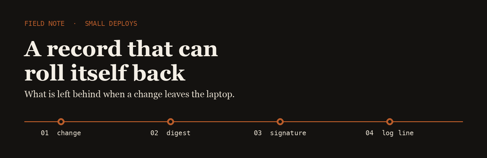
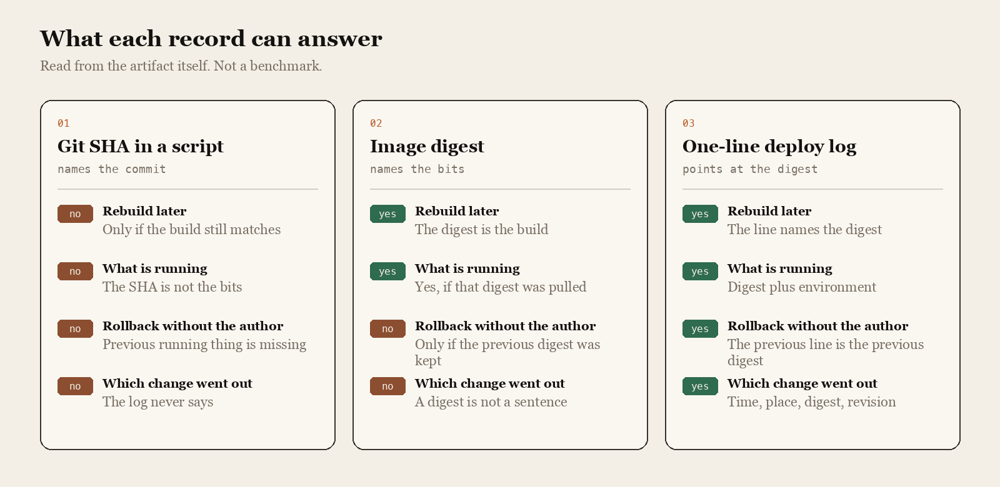

<p align="center">
  
</p>

# Cloud Rail

A rail is a fixed path. The useful part of the work is the middle of that path: a change leaves a laptop, stays identifiable, and can come back without calling the person who shipped it.

This note is about the smallest record that makes that true for a small deploy. It is not a platform. It is the question I keep asking of other people's deploy scripts.

## The question

When the deploy command finishes, what is left behind?

I kept three kinds of record that show up in real scripts and asked each one the same four questions: can I rebuild it later, does it name what production is running, can someone else roll it back, and does the log say which change went out. The answers come from what the record contains. They are not a benchmark.

<p align="center">
  
</p>

| | Git SHA in a script | Image digest | One-line deploy log |
| --- | --- | --- | --- |
| Rebuild later | Only if the build still matches | The digest is the build | The line names the digest |
| What is running | The SHA is not the bits | Yes, if that digest was pulled | Digest plus environment |
| Rollback without the author | The previous running thing is missing | Only if the previous digest was kept | The previous line is the previous digest |
| Which change went out | The log never says | A digest is not a sentence | Time, place, digest, revision |

A SHA in a comment is how a script remembers what the author meant. An image digest is how a registry remembers what was built. Neither one, on its own, tells the next person which of those bits is in production.

## The line I keep

```text
2026-03-12T09:14:03Z  prod  sha256:6c3a…e91  git 4f1c8a2
```

Four fields. Time, environment, digest, and the revision that produced the digest. The rollback is not a second system. It is the previous line, deployed again.

That line is the gap between tools that already exist:

- [ko](https://github.com/ko-build/ko) builds a Go program into an image and prints the digest. No Dockerfile sits between the revision and the bits.
- [cosign](https://github.com/sigstore/cosign) signs that digest, so the line can point at bits someone can verify.
- [Flux](https://github.com/fluxcd/flux2) keeps a cluster reconciled to the Git record that names the digest.

I keep a fork of each on this account. The note above is the part they do not write down for you: a sentence a person can read at 2am that says which digest went out, and which digest to put back.

## What I pay attention to

- A deploy that can be repeated by someone who was not in the room when it was written
- A rollback that is a command, not a meeting
- Logs that name the change, not only the color of the dashboard
- Tools small enough to read in one sitting

## Working with me

Send a short problem statement, a way to see it happen, and what done looks like. I am independent, remote, and usually around during the Bangkok workday.
